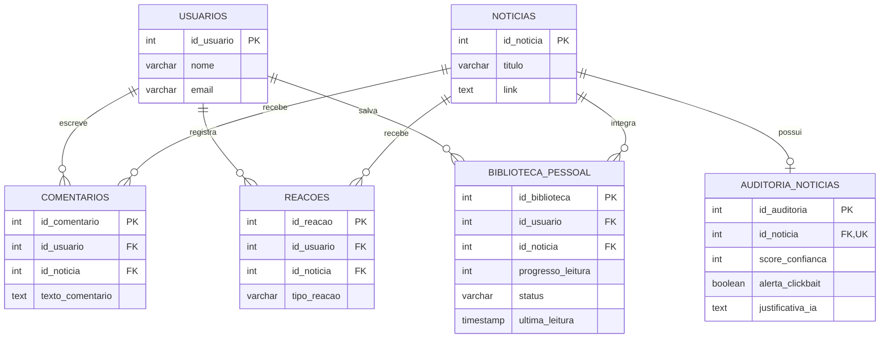

# Fase 2 — Inovação e Prototipação | Agregador de Notícias

> **Projeto acadêmico e protótipo demonstrativo.** Os resultados de avaliação de notícias são fictícios e foram inseridos manualmente para testar a estrutura do banco de dados. **Não há integração ativa com IA, API da Groq, verificação factual externa nem persistência no protótipo HTML.**

## 1. Objetivo

Evoluir o banco de dados relacional do Agregador de Notícias desenvolvido na Fase 1 com duas funcionalidades: (1) armazenar avaliações demonstrativas de notícias, como pontuação de confiança, alerta de título sensacionalista e justificativa; (2) permitir que usuários registrem notícias em sua biblioteca e acompanhem o progresso de leitura.

A inovação escolhida para a atividade é **Inteligência de Dados**. A biblioteca pessoal complementa a experiência do usuário. A estrutura SQL está preparada para receber avaliações fornecidas por uma aplicação no futuro; o projeto entregue não implementa automaticamente essas análises.

## 2. O que foi acrescentado ao banco de dados

| Nova tabela | Responsabilidade | Ligação com a Fase 1 |
|---|---|---|
| `auditoria_noticias` | Armazena, por notícia, `score_confianca` de 0 a 100, `alerta_clickbait` e `justificativa_ia` | `id_noticia` é chave estrangeira e `UNIQUE`, permitindo no máximo uma avaliação por notícia |
| `biblioteca_pessoal` | Registra a notícia salva por um usuário, o progresso entre 0 e 100, o estado da leitura e a data registrada | `id_usuario` referencia `usuarios`; `id_noticia` referencia `noticias`; o par `(id_usuario, id_noticia)` é `UNIQUE` |

O banco mantém as quatro tabelas principais da Fase 1: `usuarios`, `noticias`, `comentarios` e `reacoes`. Com as duas novas tabelas, o modelo passa a ter **seis tabelas**.

### Regras exemplificadas no SQL

- `PRIMARY KEY`: identifica cada registro de forma exclusiva.
- `FOREIGN KEY`: exige que a notícia e o usuário referenciados existam nas tabelas correspondentes.
- `UNIQUE(id_noticia)`: evita duas auditorias da mesma notícia.
- `UNIQUE(id_usuario, id_noticia)`: permite que usuários diferentes salvem a mesma notícia, mas impede que o mesmo usuário a adicione duas vezes.
- `CHECK (... BETWEEN 0 AND 100)`: limita as pontuações e os percentuais de leitura à faixa de 0 a 100 quando o valor não é nulo.
- `DEFAULT`: fornece valores iniciais quando a coluna não é informada, como `FALSE`, `0` e `CURRENT_TIMESTAMP`.

## 3. Modelo de dados — Diagrama entidade-relacionamento

As cardinalidades representam que cada comentário, reação ou item da biblioteca pertence a um usuário/notícia, e que cada notícia possui **zero ou uma** auditoria. Os campos abaixo são os relevantes para demonstrar os relacionamentos; os scripts SQL contêm a estrutura executável.



**Observação:** `UK` indica uma restrição de unicidade. A unicidade composta de `biblioteca_pessoal` está no SQL, pois um diagrama ER simplificado não expressa todas as restrições do banco. O diagrama é uma visão resumida do modelo; os scripts são a fonte para os detalhes completos das colunas e restrições.

## 4. Protótipo de interface

**[Abrir protótipo HTML da Fase 2](prototipo/index.html)**

O protótipo apresenta duas notícias com pontuações **fictícias** (95 e 40), alerta de possível clickbait e uma biblioteca de leitura com um exemplo de progresso de 60%. Ele ilustra a interface que um usuário poderia utilizar. Para visualizar localmente no navegador, abra `versao-corrigida/prototipo/index.html` no Firefox ou outro navegador.

**Escopo:** o HTML não acessa o PostgreSQL, não chama API de IA, não autentica usuários e não altera o banco. Pontuações, justificativas e progresso mostrados na tela são dados de demonstração. O protótipo pode ser aberto como arquivo local, sem servidor web.

## 5. Como executar e verificar a estrutura SQL

**Pré-requisitos:** PostgreSQL instalado e iniciado, usuário de banco `joaosousa` configurado, e acesso ao terminal na raiz do repositório `fase2`. Substitua o usuário de banco nos comandos se o seu ambiente for diferente.

A sequência abaixo parte de um banco de testes **novo e vazio**. Não execute os scripts de criação em um banco de produção.

```bash
sudo -u postgres createdb -O joaosousa agregador_noticias_fase2
psql -U joaosousa -d agregador_noticias_fase2 -v ON_ERROR_STOP=1 -f versao-corrigida/scripts/01_base_fase1.sql
psql -U joaosousa -d agregador_noticias_fase2 -v ON_ERROR_STOP=1 -f versao-corrigida/scripts/02_dados_base.sql
psql -U joaosousa -d agregador_noticias_fase2 -v ON_ERROR_STOP=1 -f versao-corrigida/scripts/03_inovacoes.sql
psql -U joaosousa -d agregador_noticias_fase2 -v ON_ERROR_STOP=1 -f versao-corrigida/scripts/04_validacao.sql
```

Caso o banco de testes já exista, **não repita `createdb`**; execute somente as consultas de validação. Se for reiniciar do zero, use um novo nome de banco ou descarte o anterior **somente após confirmar que não contém dados que deseja preservar**.

### Resultado observado nos testes locais

Na execução local de 25/11/2026, os scripts foram rodados sequencialmente e retornaram: quatro mensagens `CREATE TABLE` para a base; duas mensagens `CREATE TABLE` para as inovações; `INSERT 0 2` para duas avaliações demonstrativas; e `INSERT 0 1` para uma notícia salva. As consultas manuais encontraram duas linhas em `auditoria_noticias` e uma em `biblioteca_pessoal`. Essas observações são dos testes com os dados de demonstração, não comprovam integração com IA.

## 6. Organização dos arquivos da versão revisada

```text
versao-corrigida/
├── README.md
├── scripts/
│   ├── 01_base_fase1.sql
│   ├── 02_dados_base.sql
│   ├── 03_inovacoes.sql
│   └── 04_validacao.sql
└── prototipo/
    └── index.html
```

Os scripts `01`, `02` e `03` foram preservados dos testes já realizados. O script `04` apenas consulta os dados para facilitar a verificação da entrega.

## 7. Limitações e evolução futura

O código da Fase 2 **prepara o banco** para uma futura integração com um serviço de análise, mas a avaliação factual deve ser feita com fontes confiáveis e verificação independente. Uma pontuação produzida por um modelo não comprova a veracidade de uma notícia. Também seriam necessárias uma aplicação com API, autenticação, proteção de dados e sincronização da biblioteca para transformar o protótipo em um sistema completo.

---

**Contexto acadêmico:** esta pasta documenta a **versão revisada** da Fase 2, mantendo os arquivos originais do repositório para consulta e histórico.
